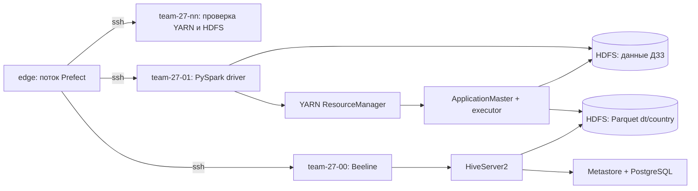

# ДЗ №5 — Prefect: Spark на YARN, HDFS и таблица

Выполнение задания на стенде **team-27**. Поток Prefect запускает Spark с `--master yarn --deploy-mode client`, читает данные ДЗ №3 из существующего HDFS, преобразует их и сохраняет партиционированную таблицу Parquet. Таблица регистрируется в Hive, результат проверяется через Beeline и REST ResourceManager.

## Что требуется и где реализовано

| Требование | Реализация |
|---|---|
| Spark под управлением YARN из предыдущих ДЗ | `remote/scripts/run-spark.sh`, проверка `sc.master == 'yarn'` в `etl_job.py`, статус приложения в REST ResourceManager |
| Подключение к HDFS из предыдущих ДЗ | `fs.defaultFS=hdfs://namenode:8020` в конфигах ДЗ №4, задача `check-yarn-hdfs-input` проверяет NameNode и входные файлы |
| Чтение данных, загруженных на HDFS | `/user/hive/practical3/orders` — файлы ДЗ №3 |
| Несколько трансформаций | тип даты и Decimal, чистка строк, фильтр, GROUP BY, count/sum/avg/countDistinct, расчёт НДС |
| Сохранение таблицы | `saveAsTable('daily_sales_p5')` с партициями `dt`, `country`, затем внешняя таблица `practical5.daily_sales` в Hive |
| Оркестрация | поток Prefect `spark-yarn-hdfs-pipeline` из четырёх задач |

## Архитектура и версии



- **Prefect 3** стоит в отдельном venv на edge-ноде. Для запуска потока отдельный сервер не нужен: Prefect поднимает временный локальный.
- **Spark 3.5.7** остаётся на `team-27-01` из ДЗ №4 (venv, конфиги, туннель WireGuard `wg-spark`). Драйвер работает на этой ВМ, ApplicationMaster и executor выделяет существующий YARN.
- **Hadoop 3.4.1** (HDFS и YARN) из ДЗ №1–2 на `team-27-nn`, **Hive 4.0.0** из ДЗ №3 на `team-27-00`.
- Prefect не стоит на `team-27-01`: там мало памяти (около 3 GiB), и она нужна драйверу Spark.

### Как связаны Spark и Hive

Как и в ДЗ №4: Spark 3.5 не умеет работать с Hive Metastore 4.0, поэтому он пишет совместимые файлы Parquet, а поток регистрирует те же файлы в Hive командой `CREATE EXTERNAL TABLE` и `MSCK REPAIR`. Копий данных нет. `saveAsTable` создаёт таблицу в каталоге текущей сессии Spark, а постоянные метаданные хранит PostgreSQL Metastore.

## Предварительные условия

- Работают HDFS, YARN и Hive из ДЗ №1–3, на `team-27-01` развёрнуто ДЗ №4 в `/opt/spark-yarn-practical-4`.
- Данные ДЗ №3 лежат в `/user/hive/practical3/orders`.
- На `team-27-01` активны `wg-quick@wg-spark` и `spark-yarn-route`.
- На edge есть `~/.ssh/team_internal`, Python 3.12, доступ в интернет для pip и sudo без пароля.

## Развёртывание и запуск

Скопировать репозиторий на edge:

```bash
scp -r spark-prefect-practical-5 team@2.59.81.216:~/
ssh team@2.59.81.216
cd ~/spark-prefect-practical-5
```

Установить и запустить:

```bash
scripts/setup.sh
scripts/run.sh
```

`setup.sh` проверяет, что ДЗ №4 на месте, создаёт venv с Prefect, копирует `remote/` на `team-27-01` в `~/spark-prefect-practical-5`.

`run.sh` запускает поток, он выполняет по порядку:

1. `check-yarn-hdfs-input` — YARN в состоянии STARTED, есть живые NodeManager и DataNode, туннель до Spark-узла активен, во входном каталоге HDFS есть файлы.
2. `spark-etl-on-yarn` — `spark-submit` на `team-27-01`, ждёт завершения и забирает отчёт из лога.
3. `register-hive-table` — создаёт базу `practical5` и внешнюю таблицу, делает `MSCK REPAIR`.
4. `verify-result` — через Beeline сравнивает число строк, партиций и сумму `gross_amount` со Spark, затем проверяет в REST YARN тип `SPARK`, состояние `FINISHED`, результат `SUCCEEDED`.

Повторный запуск перезаписывает только результат этого ДЗ, исходные данные не меняются. Одновременно с ДЗ №4 поток запускать нельзя: у драйвера Spark фиксированные порты 39001 и 39002.

### Память учебного стенда

Параметры Spark берутся из `config/spark-defaults.conf` ДЗ №4: один executor (512 MiB heap + 128 MiB overhead), ApplicationMaster 128+128 MiB, драйвер 768 MiB. У каждого NodeManager всего 768 MiB, так что для большого набора данных ресурсы придётся увеличивать.

## Обработка данных

`remote/app/etl_job.py` создаёт одну SparkSession и делает всё в ней. Источник — CSV-файлы ДЗ №3 в каталогах `dt=.../country=...`: колонки партиций Spark берёт из путей, схема задана явно.

Выход: `/user/spark/practical4/prefect_daily_sales`, формат Parquet, партиции `dt DATE`, `country STRING`. Поля: количество заказов, сумма, среднее, число разных товаров, условный НДС 20% от суммы.

Для встроенного примера ДЗ №3 (8 заказов) получается 4 строки, итого сумма 360.00 и НДС 72.00, как в ДЗ №4.

## Ручная проверка через Hive

```bash
ssh -i ~/.ssh/team_internal team@team-27-00
cd /opt/hive-cluster-practical-3
sudo scripts/beeline.sh -e "SELECT * FROM practical5.daily_sales;"
sudo scripts/beeline.sh -e "SHOW PARTITIONS practical5.daily_sales;"
```

## Диагностика

```bash
# на edge: итог последнего запуска
cat logs/summary.json
cat logs/spark-result.json

# на Spark-узле: полный лог spark-submit
tail -n 50 ~/spark-prefect-practical-5/logs/spark-submit.log
sudo systemctl status wg-quick@wg-spark spark-yarn-route
```

| Симптом | Что делать |
|---|---|
| `Permission denied (publickey)` | проверить, что на edge есть `~/.ssh/team_internal` |
| Задача 1 ругается на туннель | `sudo systemctl restart wg-quick@wg-spark spark-yarn-route` на `team-27-01` |
| Приложение Spark висит в `ACCEPTED` | на YARN не хватает памяти, завершить чужие приложения |
| `Address already in use` для 39001/39002 | ещё работает другой драйвер Spark |
| `python3 -m venv` не работает | `sudo apt-get install -y python3-venv` и снова `scripts/setup.sh` |

## Структура репозитория

```
spark-prefect-practical-5/
├── README.md
├── requirements.txt
├── flows/pipeline.py          # поток Prefect (запускается на edge)
├── remote/
│   ├── app/etl_job.py         # Spark-задача (копируется на team-27-01)
│   └── scripts/run-spark.sh
├── scripts/
│   ├── setup.sh
│   └── run.sh
└── logs/                      # результаты запусков
```

## Документация

- [Prefect](https://docs.prefect.io/)
- [Spark 3.5.7: запуск на YARN](https://spark.apache.org/docs/3.5.7/running-on-yarn.html)
- [Запись и partitionBy](https://spark.apache.org/docs/3.5.7/api/scala/org/apache/spark/sql/DataFrameWriter.html)
- [Hive: внешние таблицы](https://hive.apache.org/docs/latest/language/languagemanual-ddl/)

При решении задания использовался ИИ (Claude, Anthropic).
